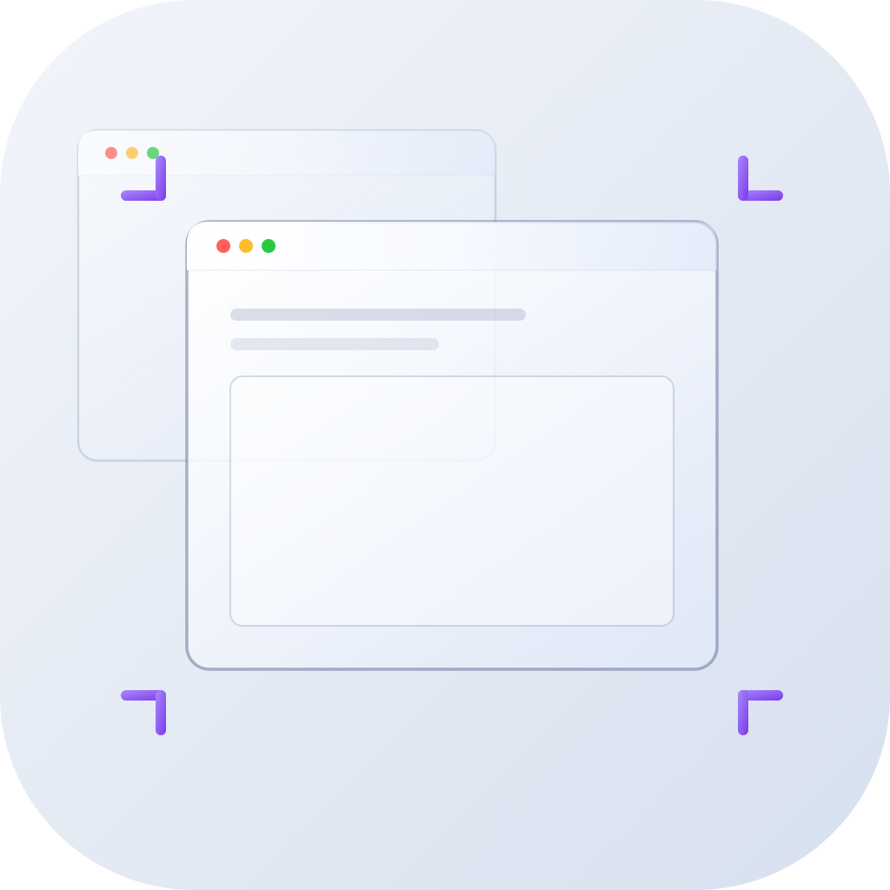
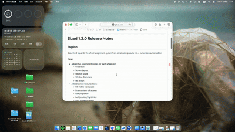
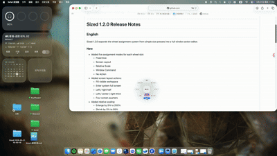

<p align="center">
  
</p>

<h1 align="center">Sized</h1>

<p align="center">
  A native macOS radial window manager for resizing, arranging, scaling, and commanding the frontmost window.
</p>

<p align="center">
  <a href="#english">English</a>&nbsp;&nbsp;|&nbsp;&nbsp;<a href="#中文">中文</a>
</p>

---

<p align="center">
  
</p>

<p align="center">
  
</p>

---

## English

Sized is a native macOS window management tool built around a radial menu. Trigger the wheel, move toward a slot, preview the target area, and release to apply the action to the current frontmost window.

It started as a fast preset-size resizer. It now supports full workspace layouts, relative scaling, destructive-action warnings, app-specific rules, and fully configurable wheel assignments.

### Highlights

- **Radial workflow**: 8 directional slots plus a center slot, designed for fast mouse or trackpad gestures.
- **Live target preview**: See the exact target frame before confirming a resize or layout action.
- **Danger preview**: Closing a window or quitting its app shows a red overlay on the focused window before confirmation.
- **Fixed sizes**: Choose pixel-level presets such as `1280 x 720`, `1920 x 1080`, or custom width and height.
- **Screen layouts**: Fill the visible workspace, enter system full screen, move to left/right half, left/center/right third, or any screen quarter.
- **Relative scaling**: Enlarge by `5%` to `200%`, shrink by `5%` to `95%`, and anchor scaling from top-left, top-right, or center.
- **Window commands**: Minimize, close window, quit application, restore initial frame, or undo the last resize.
- **App-specific rules**: Use different slot assignments for different apps by bundle identifier.
- **Custom appearance**: Tune wheel size, thickness, corner radius, center badge, colors, animation, preview style, and haptics.
- **Import and export**: Back up or share settings as JSON.

### Requirements

- macOS 14.0 Sonoma or later
- Accessibility permission, required for reading and controlling windows

### Default Trigger

Use **middle-click** to open the wheel, or hold the default keyboard trigger **Control-E (⌃E)**. Move the pointer toward a slot and release to confirm. You can change the trigger behavior in Settings.

### Default Wheel Mapping

| Slot | Default action |
| --- | --- |
| Center | Fixed size `1280 x 720` |
| Top | Fill visible workspace |
| Bottom | Restore initial frame |
| Left | Left half |
| Right | Right half |
| Top-left | Top-left quarter |
| Top-right | Top-right quarter |
| Bottom-left | Bottom-left quarter |
| Bottom-right | Bottom-right quarter |

### Assignment Modes

Each slot can be assigned one of five action modes:

| Mode | What it does |
| --- | --- |
| Fixed Size | Resize the focused window to a preset or custom pixel size. |
| Screen Layout | Move and resize the window relative to the current screen's visible workspace. |
| Relative Scale | Enlarge or shrink the current window by a percentage. |
| Window Command | Minimize, close, quit app, restore initial frame, or undo last resize. |
| No Action | Leave the slot intentionally empty. |

### Notes

- The visible workspace excludes the menu bar and Dock.
- System full screen uses the target app's accessibility full-screen or zoom button. If the app does not support it, the action fails instead of falling back to a normal resize.
- Some apps enforce their own minimum and maximum window sizes. Sized asks for the target frame, but the app may constrain the final result.
- Destructive actions do not show a second confirmation dialog. The red overlay is the warning.

### Build From Source

Open `Sized.xcodeproj` in Xcode and build the `Sized` scheme, or run:

```sh
xcodebuild -project Sized.xcodeproj -scheme Sized -configuration Debug build
```

### Privacy

Sized works locally through macOS accessibility APIs. Settings are stored locally in UserDefaults. No window titles, app data, or configuration data is uploaded by Sized.

### Acknowledgments

Inspired by [Loop](https://github.com/MrKai77/Loop). Window transform animation and preview transitions are adapted from Loop by Kai Azim and contributors; see [THIRD_PARTY_NOTICES.md](THIRD_PARTY_NOTICES.md).

---

## 中文

Sized 是一款 macOS 原生窗口管理工具，核心交互是径向轮盘。呼出轮盘，鼠标滑向某个槽位，先看到目标区域预览，松手后对当前焦点窗口执行对应动作。

它最初是一个快速尺寸调整工具。现在可以做工作区布局、相对缩放、危险动作警示、按应用分配规则，以及完整的槽位自定义。

### 亮点

- **轮盘操作**：8 个方向槽位加中心槽位，适合快速鼠标或触控板手势。
- **实时目标预览**：调整尺寸或移动布局前，先看到目标窗口区域。
- **危险动作预览**：关闭窗口或退出应用前，会在当前焦点窗口上显示红色遮罩。
- **固定尺寸**：选择像素级预设，例如 `1280 x 720`、`1920 x 1080`，也可以输入自定义宽高。
- **屏幕布局**：铺满可见工作区、进入系统全屏、左/右半屏、左/中/右三分之一、四角四分之一。
- **相对缩放**：放大 `5%` 到 `200%`，缩小 `5%` 到 `95%`，支持左上、右上、中心三种锚点。
- **窗口命令**：最小化、关闭窗口、退出应用、恢复初始尺寸、撤销上一次尺寸。
- **应用规则**：按 Bundle Identifier 为不同 App 配置不同的轮盘槽位。
- **外观可定制**：轮盘大小、厚度、圆角、中心区域、颜色、动画、预览窗口和触觉反馈都可以调。
- **导入导出**：用 JSON 备份或迁移配置。

### 系统要求

- macOS 14.0 Sonoma 或更高版本
- 辅助功能权限，用于读取和控制窗口

### 默认触发方式

默认可以用 **鼠标中键** 呼出轮盘，也可以按住默认键盘触发键 **Control-E (⌃E)**。鼠标移动到目标槽位后松手确认。触发方式可以在设置里修改。

### 默认轮盘分配

| 槽位 | 默认动作 |
| --- | --- |
| 中心 | 固定尺寸 `1280 x 720` |
| 上 | 铺满可见工作区 |
| 下 | 恢复初始尺寸 |
| 左 | 左半屏 |
| 右 | 右半屏 |
| 左上 | 左上四分之一 |
| 右上 | 右上四分之一 |
| 左下 | 左下四分之一 |
| 右下 | 右下四分之一 |

### 槽位模式

每个槽位可以选择五种模式：

| 模式 | 作用 |
| --- | --- |
| 固定尺寸 | 将当前焦点窗口调整到预设或自定义像素尺寸。 |
| 屏幕布局 | 基于当前屏幕的可见工作区移动并调整窗口。 |
| 相对缩放 | 按百分比放大或缩小当前窗口。 |
| 窗口命令 | 最小化、关闭、退出应用、恢复初始尺寸、撤销上一次尺寸。 |
| 无操作 | 让该槽位保持空置。 |

### 说明

- 可见工作区会避开菜单栏和 Dock。
- 系统全屏会调用目标 App 的辅助功能全屏按钮或绿色按钮。如果目标 App 不支持，该动作会失败，不会自动退化成普通铺满。
- 部分 App 会限制窗口最小或最大尺寸。Sized 会请求目标尺寸，但最终结果可能被 App 自身约束。
- 危险动作不会再弹出二次确认框，红色遮罩就是确认前的警示。

### 从源码构建

用 Xcode 打开 `Sized.xcodeproj` 并构建 `Sized` scheme，或运行：

```sh
xcodebuild -project Sized.xcodeproj -scheme Sized -configuration Debug build
```

### 隐私

Sized 通过 macOS 辅助功能 API 在本机工作。设置保存在本地 UserDefaults 中。Sized 不会上传窗口标题、应用数据或配置数据。

### 致谢

灵感来源于 [Loop](https://github.com/MrKai77/Loop)。窗口变换动画与预览过渡改编自 Kai Azim 及贡献者的 Loop 实现，详见 [第三方声明](THIRD_PARTY_NOTICES.md)。

---

## License / 许可证

Copyright (C) 2026 baikaihao.

Sized is licensed under the **GNU Affero General Public License, version 3 only** (`AGPL-3.0-only`). You may use, modify, and distribute it, including commercially, under the terms of this license. When distributing covered software, provide its Corresponding Source as required by the license. If you modify the software and your version supports remote network interaction, you must prominently offer those users access to the Corresponding Source of your version at no charge.

This software is provided without any warranty. See [LICENSE](LICENSE) for the complete terms.

Sized 采用 **GNU Affero 通用公共许可证第 3 版（仅此版本）**（`AGPL-3.0-only`）。允许在遵守许可证的前提下使用、修改、分发及商业使用。分发受该许可证覆盖的软件时，须按许可证要求提供对应源码；如果修改版支持通过网络远程交互，须向这些用户显著提供免费获取该修改版对应源码的途径。

本软件不提供任何担保。完整条款见 [LICENSE](LICENSE)。
